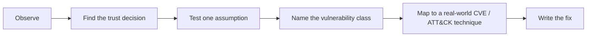
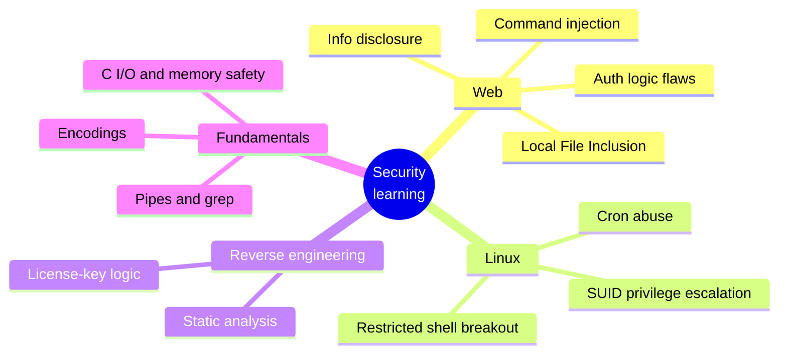

<div align="center">

# 🛡️ Cybersecurity CTF Writeups
### Hands-on notes on how systems break, and how to fix them


*I write up the **why**, not just the answer, and I keep my mistakes in.*

</div>

> ⚠️ **Ethics:** Everything here was done in legal, purpose-built training environments (OverTheWire, picoCTF). Flags and passwords are redacted. Never test on systems you don't own or have written permission to test.

---

## 🧭 How I approach every challenge



## 📊 Progress

| Platform | Track | Status | Writeups |
|---|---|:-:|---|
| OverTheWire | **Natas 0–9** (web) | 🟡 In progress | [Natas 1–9 · Thinking like an attacker](overthewire/natas/README.md) |
| OverTheWire | **Bandit** (Linux) | ✅ Done | [Index](overthewire/bandit/README.md) |
| picoCTF | General Skills / Crypto / RE | 🟡 In progress | [Index](picoCTF/README.md) |
| C & systems | I/O, unsafe functions | 🟡 Notes | [stdio & unsafe functions](c-and-systems/stdio-buffering-and-unsafe-functions.md) |

## 🗺️ Skills map



## 📂 Repo layout

```text
.
├── overthewire/
│   ├── natas/      web vulnerabilities, levels 1–9
│   └── bandit/     Linux, privilege escalation, shell breakout
├── picoCTF/
│   ├── general-skills/
│   ├── cryptography/
│   └── reverse-engineering/
└── c-and-systems/
```

## 🚧 Roadmap

- [ ] Natas 10+ (filter bypass, SQL injection, session logic)
- [ ] Finish Bandit and add the remaining level notes
- [ ] PortSwigger Web Security Academy labs
- [ ] **Windows & Active Directory** (Kerberoasting, pass-the-hash, BloodHound-style attack paths). Bandit doesn't cover it, and most corporate environments are Windows domains
- [ ] Buffer overflow from first principles (stack layout, GDB, protections)
