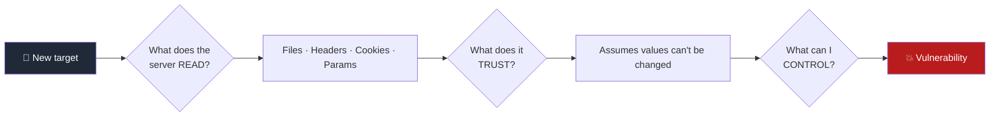
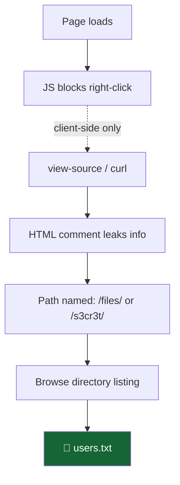
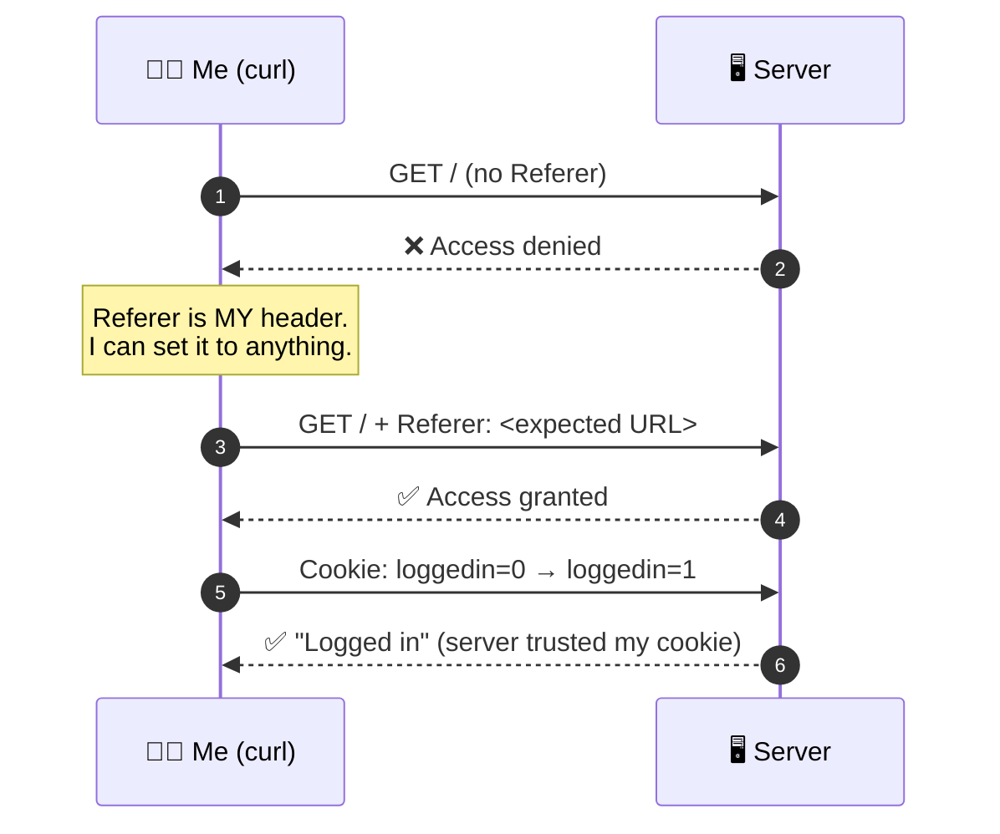
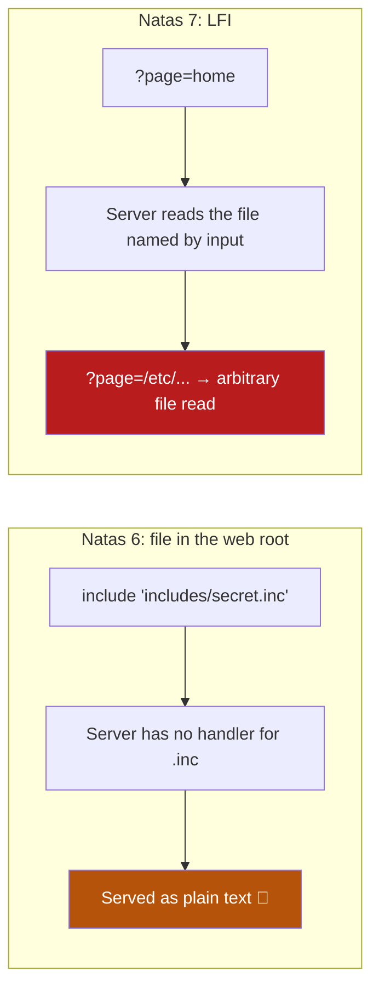
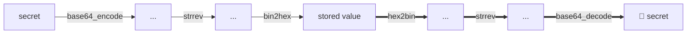

<div align="center">

# 🕵️ Thinking Like an Attacker
### What OverTheWire **Natas 1–9** taught me about how web apps break


*Not a list of passwords. A map of **patterns**.*

</div>

> ⚠️ **Scope:** All testing was done on the intentionally vulnerable OverTheWire Natas lab. Passwords are redacted on purpose. Never test these techniques on systems you don't own or have written permission to test.

---

## 📌 Why this exists

Anyone can google a Natas password. What I wanted was the **reusable way of looking at a web app** and asking:

> *"Where does this app trust me, and where does that trust break?"*

By level 9, every challenge fit into a small number of categories. This repo is that map.

---

## 🧠 The one mental model: **Read → Trust → Control**



Every bug below is a failure of one of those three questions.

---

## 🗺️ Overview

| # | Challenge idea | Vulnerability class | CWE | Attacker's question |
|:-:|---|---|:-:|---|
| 1 | Right-click disabled | Info disclosure in comments | CWE-200 | What's in the source? |
| 2 | "Nothing on this page" | Directory listing | CWE-548 | What will the server list? |
| 3 | Comment points to hidden dir | Comments → forced browsing | CWE-200 | What paths are named? |
| 4 | Referer check | Trust in client header | CWE-290 | Which headers can I forge? |
| 5 | `loggedin=0` cookie | Client-side auth state | CWE-565 | What state do I control? |
| 6 | `includes/secret.inc` | Raw file exposure | CWE-433 | What's meant to be internal? |
| 7 | `?page=` parameter | Local File Inclusion | CWE-98 / 22 | What file does my input pick? |
| 8 | Encoded secret | Security through obscurity | CWE-656 | Can I run it backwards? |
| 9 | Search box → `grep` | OS Command Injection | CWE-78 | What command is my input part of? |

---

## 🔬 Level by level

### 🟢 Natas 1–3 · *If it reaches the browser, it's public*



- **L1:** The right-click block is JavaScript. The HTML still reaches me, so `view-source:` or `curl` shows everything.
- **L2:** An image loads from `/files/`. The directory has listing enabled. The server *told me* the filenames.
- **L3:** A comment names a hidden directory. Same class as L1, but now it gives a path to request directly.
- **🌍 Real world:** Exposed `/backup/`, `/uploads/`, `.git/` folders, plus secrets in HTML/JS comments, are recurring bug-bounty findings.

---

### 🟡 Natas 4–5 · *The client is not an authority*



- **L4:** Authorization depended on a header I fully control: `curl -H "Referer: ..."`.
- **L5:** The cookie `loggedin=0` decided access. I own the cookie, so I own the decision.
- **🌍 Real world:** Same family as JWT mistakes like accepting `alg: none`. Anything the client stores about permissions must be **re-verified server-side**.

---

### 🟠 Natas 6–7 · *Input becomes a file path*



- **L6:** The developer meant the file to be *included*, not *requested*. It sat inside the web root, so it was served as text.
- **L7:** The developer expected a page name. The server treated it as a **file path**.
- **🌍 Real world:** CVE-2018-12613 (phpMyAdmin LFI) is the same mistake: user input decides which file the server reads. Also: `.env`, `.bak`, `.inc` left in public directories.

---

### 🔴 Natas 8 · *Encoding is not encryption*



The encoding code was visible in the source. I didn't *break* anything. I ran the **inverse chain in reverse order**.

- **🌍 Real world:** Obfuscated secrets and hardcoded keys in client-side JS bundles. If the algorithm (and key) ship to the browser, the secret is public.

---

### 💀 Natas 9 · *Input pasted into a shell*

```mermaid
sequenceDiagram
    autonumber
    participant Me as 🧑‍💻 Attacker
    participant App as 🌐 PHP app
    participant Sh as 🐚 Shell
    Me->>App: needle = "; <my command> #"
    App->>Sh: grep -i ; <my command> # dictionary.txt
    Note over Sh: ";" ends grep<br/>"#" comments out the rest
    Sh-->>App: output of MY command
    App-->>Me: 🔑 result on the page
```

- The app built `grep -i $key dictionary.txt` straight from my input. I wasn't searching; I was **writing shell**.
- **🌍 Real world:** CVE-2014-6271 (Shellshock) and CVE-2021-22986 (F5 BIG-IP iControl REST) are command injection in production. The fix is always the same: never concatenate user input into a shell string.

---

## ✅ My attacker's checklist

```text
□ Read the source        → view-source, JS bundles, comments, robots.txt
□ Enumerate paths        → directory listing? hidden routes?
□ Find trust decisions   → cookies, headers, hidden fields, URL params
□ Ask "can I change it?" → if the client sends it, assume yes
□ Trace input to a sink  → file path, shell command, SQL query, include
□ Test, don't guess      → craft ONE request that proves the assumption
□ Think in classes       → "what kind of bug is this?" → find sibling CVEs
```

## 🛡️ What I'd tell a developer

| Rule | Why |
|---|---|
| **Allow-list, never deny-list** | Permit `home`, `about`; reject everything else |
| **Never trust client state for authz** | Re-check permissions server-side on every request |
| **Keep secrets out of the web root** | `.env`, `.inc`, backups, `.git` must not be servable |
| **Never concatenate input into a shell** | Avoid the shell entirely; `escapeshellarg()` as a fallback |
| **Never build paths from raw input** | `basename()` + an allow-list map |
| **Obscurity ≠ security** | If the algorithm ships to the client, so does the secret |
| **Patch fast** | Most CVEs above were fixed quickly; breaches happen when patches lag |

---

## 🚀 Roadmap

- [x] Natas 0–9: source disclosure, auth logic, LFI, command injection
- [ ] Natas 10–15: filter bypasses, blind injection
- [ ] Natas 16+: SQL injection, session logic
- [ ] Next: OverTheWire **Bandit** → PortSwigger **Web Security Academy** labs

---

<div align="center">

*If you're working through Natas too: don't skip the "why." The password is the least valuable thing you'll take away.*

</div>
